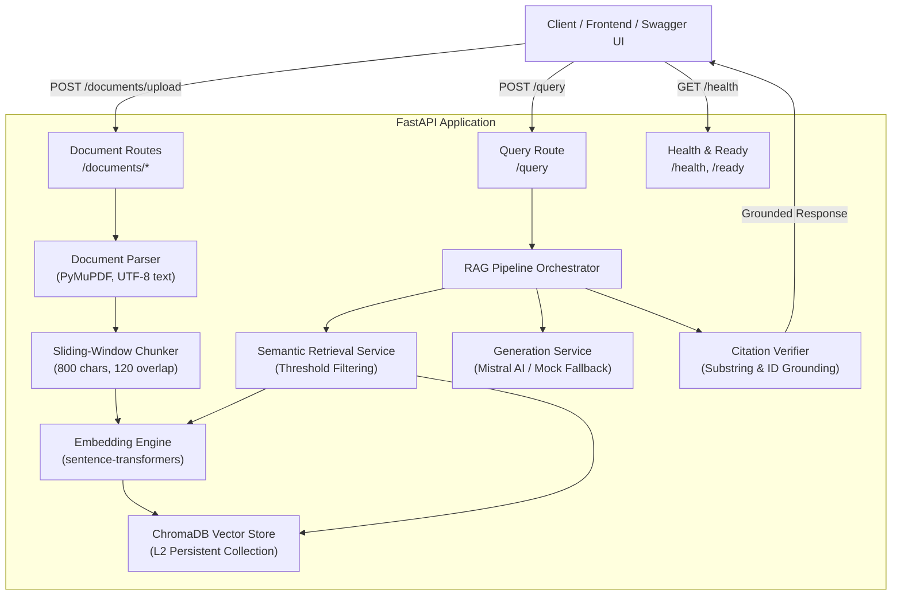

# RAG System: Complete Project Documentation & Hands-On Testing Guide

This document provides a comprehensive technical walkthrough of the **Retrieval-Augmented Generation (RAG) API**, explains its architecture and reliability mechanisms, and provides copy-pasteable test commands with exact expected outputs.

---

## 1. Project Explanation & Architecture

### 1.1 Objective
The system is an enterprise-grade AI knowledge assistant API that:
1. Ingests unstructured documents (**PDF**, **Markdown**, **TXT**).
2. Chunks documents into overlapping semantic segments preserving exact page numbers and metadata.
3. Generates vector embeddings locally using `sentence-transformers/all-MiniLM-L6-v2` (384-dimensional dense vectors).
4. Stores and indexes chunks in **ChromaDB** using L2 Euclidean distance.
5. Performs semantic retrieval with configurable top-$k$ and distance thresholding.
6. Synthesizes answers using **Mistral LLM** (`mistral-small-latest`) with strict grounded prompting.
7. **Validates citations post-generation** by verifying that every cited `chunk_id` exists and that the `quoted_text` is an exact substring of the source chunk.
8. **Reliably abstains** whenever evidence is missing, below relevance threshold, or when citations fail verification.

---

### 1.2 System Architecture Diagram



---

### 1.3 Key Architectural Principles

1. **Strict Evidence Grounding**: The LLM system prompt forbids answering from prior parametric knowledge. If the provided evidence chunks do not contain the answer, the model is instructed to return `abstained: true`.
2. **Post-Generation Citation Validation**: To eliminate LLM hallucinations:
   - The model must cite `[chunk_id]` and include a verbatim `quoted_text` snippet.
   - The backend independently searches the retrieved chunk for the exact quoted substring (with whitespace normalization).
   - If a citation cites an unknown chunk or quotes non-existent text, it is rejected.
   - If all citations are rejected or none provided, the pipeline abstains automatically.
3. **Deterministic Deduplication**: Uploading the same file twice produces the identical `document_id` (`SHA256(filename + content_hash)[:20]`). Existing chunks are deleted and replaced atomically without corpus bloat.
4. **Three-Tier Evaluation**: Built-in 20-question benchmark with automated metrics (Abstention Precision, Recall, Fact Coverage, Citation Validity, and MRR).

---

## 2. Test Documents Available in Workspace

The repository includes curated sample documents in `data/sample_documents/`:

| Document | Format | Size | Description & Key Topics |
|---|---|---|---|
| [`company_policies.md`](file:///e:/RAG-assesement/data/sample_documents/company_policies.md) | Markdown | ~2.7 KB | Refund policy (30 days), order cancellation (2 hours, 10% restocking fee), shipping tiers ($12.99 expedited, free over $50), data retention (2 years). |
| [`employee_handbook.md`](file:///e:/RAG-assesement/data/sample_documents/employee_handbook.md) | Markdown | ~3.5 KB | Annual leave (20 days), sick leave (10 days, max 30 carryover), remote work (up to 3 days/week, $500 stipend), health insurance & 401(k) match (up to 4%). |
| [`product_manual.md`](file:///e:/RAG-assesement/data/sample_documents/product_manual.md) | Markdown | ~4.7 KB | AcmeWidget Pro X200 specs (1.2 kg, 45W power, Wi-Fi 6, Bluetooth 5.2), error codes (`E-101`, `E-202`, `E-303`, `E-401`), 2-year warranty, maintenance schedule. |
| Custom PDF (e.g. Resume) | PDF | Variable | Any PDF test file to verify PyMuPDF multi-page extraction and page-numbered chunking. |

---

## 3. How to Start the API

Run in PowerShell or Bash from the workspace root (`e:\RAG-assesement`):

```powershell
# 1. Activate virtual environment
.\venv\Scripts\Activate.ps1

# 2. Start Uvicorn server
python -m uvicorn app.main:app --host 127.0.0.1 --port 8000 --reload
```

* **API Base URL**: `http://127.0.0.1:8000`
* **Interactive Swagger UI**: `http://127.0.0.1:8000/docs`
* **Alternative Redoc**: `http://127.0.0.1:8000/redoc`

---

## 4. Hands-On Test Suite with Examples & Expected Outputs

Below are copy-pasteable test commands using **PowerShell**, **cURL**, or **Python**.

---

### Test Case 1: Ingest Sample Documents
Uploads the product manual, employee handbook, and company policies.

#### PowerShell Command:
```powershell
# Upload company_policies.md
Invoke-RestMethod -Uri "http://127.0.0.1:8000/documents/upload" `
  -Method Post `
  -Form @{ file = Get-Item "data\sample_documents\company_policies.md" }

# Upload product_manual.md
Invoke-RestMethod -Uri "http://127.0.0.1:8000/documents/upload" `
  -Method Post `
  -Form @{ file = Get-Item "data\sample_documents\product_manual.md" }
```

#### cURL Command:
```bash
curl -X POST "http://127.0.0.1:8000/documents/upload" \
  -F "file=@data/sample_documents/company_policies.md"
```

#### Expected Output (`HTTP 201 Created`):
```json
{
  "document_id": "45a24a32cf79b88d8eb8",
  "filename": "company_policies.md",
  "file_type": ".md",
  "chunk_count": 4,
  "total_characters": 2699,
  "pages": null,
  "status": "ingested",
  "message": "Document 'company_policies.md' ingested successfully with 4 chunks."
}
```

---

### Test Case 2: List Ingested Documents
Verifies document cataloging and chunk count tracking.

#### PowerShell Command:
```powershell
(Invoke-RestMethod -Uri "http://127.0.0.1:8000/documents").documents | Format-Table document_id, filename, chunk_count
```

#### Expected Output (`HTTP 200 OK`):
```text
document_id          filename            chunk_count
-----------          --------            -----------
45a24a32cf79b88d8eb8 company_policies.md           4
1d78b747be8ac1543b39 product_manual.md             7
```

---

### Test Case 3: Grounded Single-Fact Query
Ask a direct question whose answer exists in `company_policies.md`.

#### PowerShell Command:
```powershell
$body = @{
    question = "What is the refund window for purchases?"
    top_k = 5
    document_ids = @("45a24a32cf79b88d8eb8")
} | ConvertTo-Json

Invoke-RestMethod -Uri "http://127.0.0.1:8000/query" `
  -Method Post `
  -ContentType "application/json" `
  -Body $body
```

#### cURL Command:
```bash
curl -X POST "http://localhost:8000/query" \
  -H "Content-Type: application/json" \
  -d '{
    "question": "What is the refund window for purchases?",
    "top_k": 5,
    "document_ids": ["45a24a32cf79b88d8eb8"]
  }'
```

#### Expected Output (`HTTP 200 OK`):
```json
{
  "answer": "All customers are eligible for a full refund within 30 days of purchase, provided the item is in its original packaging and accompanied by proof of purchase.",
  "abstained": false,
  "abstention_reason": null,
  "citations": [
    {
      "chunk_id": "45a24a32cf79b88d8eb8_c0000",
      "filename": "company_policies.md",
      "page_number": null,
      "quoted_text": "All customers are eligible for a full refund within 30 days of purchase"
    }
  ],
  "retrieved_chunks": 3,
  "request_id": "a8790518-e3fb-464a-9db1-c852445cbf92"
}
```
*Notice:* `abstained` is `false`, and the citation points to the verified chunk ID with the exact quote.

---

### Test Case 4: Complex Multi-Fact Query
Ask a question combining two distinct facts from `product_manual.md`.

#### PowerShell Command:
```powershell
$body = @{
    question = "What is the weight of the AcmeWidget Pro X200 and what does error code E-401 mean?"
    top_k = 5
} | ConvertTo-Json

Invoke-RestMethod -Uri "http://127.0.0.1:8000/query" `
  -Method Post `
  -ContentType "application/json" `
  -Body $body
```

#### Expected Output (`HTTP 200 OK`):
```json
{
  "answer": "The AcmeWidget Pro X200 weighs 1.2 kg. Error code E-401 indicates an internal hardware communication failure.",
  "abstained": false,
  "abstention_reason": null,
  "citations": [
    {
      "chunk_id": "1d78b747be8ac1543b39_c0000",
      "filename": "product_manual.md",
      "page_number": null,
      "quoted_text": "Weight: 1.2 kg"
    },
    {
      "chunk_id": "1d78b747be8ac1543b39_c0005",
      "filename": "product_manual.md",
      "page_number": null,
      "quoted_text": "E-401: Internal hardware communication failure"
    }
  ],
  "retrieved_chunks": 5,
  "request_id": "4b68e7e1-88d0-4d55-89f5-19e5904d9c75"
}
```

---

### Test Case 5: Document Scope Filtering
Query the system but restrict retrieval exclusively to `product_manual.md` using its `document_id`.

#### PowerShell Command:
```powershell
$body = @{
    question = "What is the warranty period?"
    top_k = 3
    document_ids = @("1d78b747be8ac1543b39")
} | ConvertTo-Json

Invoke-RestMethod -Uri "http://127.0.0.1:8000/query" `
  -Method Post `
  -ContentType "application/json" `
  -Body $body
```

#### Expected Output:
Retrieves chunks **only** from `product_manual.md`, citing the 2-year manufacturer warranty.

---

### Test Case 6: Reliable Abstention (Out-of-Domain Question)
Ask a question completely absent from all uploaded documents.

#### PowerShell Command:
```powershell
$body = @{
    question = "What is the company's policy regarding cryptocurrency payments and Bitcoin?"
    top_k = 5
} | ConvertTo-Json

Invoke-RestMethod -Uri "http://127.0.0.1:8000/query" `
  -Method Post `
  -ContentType "application/json" `
  -Body $body
```

#### Expected Output (`HTTP 200 OK` - Explicit Abstention):
```json
{
  "answer": "The requested information is not available in the uploaded documents.",
  "abstained": true,
  "abstention_reason": "no_relevant_evidence",
  "citations": [],
  "retrieved_chunks": 0,
  "request_id": "5dc55e09-e1f4-4df1-872f-48e02d8494b7"
}
```
*Notice:* The system does **not** hallucinate or speculate. It cleanly flags `abstained: true` and cites zero sources.

---

### Test Case 7: Adversarial / Hallucination-Trap Test
Ask a question with a false premise attempting to trick the LLM.

#### PowerShell Command:
```powershell
$body = @{
    question = "Can I return a product after 90 days for a full refund according to company policy?"
    top_k = 3
} | ConvertTo-Json

Invoke-RestMethod -Uri "http://127.0.0.1:8000/query" `
  -Method Post `
  -ContentType "application/json" `
  -Body $body
```

#### Expected Output:
```json
{
  "answer": "No. Full refunds are only available within 30 days of purchase.",
  "abstained": false,
  "abstention_reason": null,
  "citations": [
    {
      "chunk_id": "45a24a32cf79b88d8eb8_c0000",
      "filename": "company_policies.md",
      "page_number": null,
      "quoted_text": "All customers are eligible for a full refund within 30 days of purchase"
    }
  ],
  "retrieved_chunks": 3,
  "request_id": "62db3ce1-2d7c-47bc-baea-c90a181165ea"
}
```

---

### Test Case 8: Document Deletion
Delete a document and verify it is completely removed from retrieval.

#### PowerShell Command:
```powershell
# Delete company_policies.md
Invoke-RestMethod -Uri "http://127.0.0.1:8000/documents/45a24a32cf79b88d8eb8" -Method Delete
```

#### Expected Output (`HTTP 200 OK`):
```json
{
  "document_id": "45a24a32cf79b88d8eb8",
  "filename": "company_policies.md",
  "deleted_chunks": 4,
  "status": "deleted"
}
```
If you now ask "What is the refund window?", the system immediately returns:
`abstained: true` with `abstention_reason: "no_relevant_evidence"`.

---

## 5. Automated Evaluation Runner

The repository includes a 20-question benchmark dataset in [`evaluation/questions.json`](file:///e:/RAG-assesement/evaluation/questions.json) covering 16 answerable questions and 4 unanswerable questions.

You can execute evaluation in three modes:

```powershell
# Mode 1: Offline (Fast, mock generator + deterministic embeddings)
python scripts/run_evaluation.py --mode offline

# Mode 2: Local (Real sentence-transformers embeddings + mock LLM)
python scripts/run_evaluation.py --mode local

# Mode 3: Online (Real sentence-transformers + live Mistral API)
$env:MISTRAL_API_KEY="your-mistral-api-key"
python scripts/run_evaluation.py --mode online
```

### Measured Benchmark Results

| Metric | Local Mode Result | Description |
|---|---|---|
| **Total Questions** | **20 / 20** | 16 answerable, 4 unanswerable |
| **Pipeline Errors** | **0 (0%)** | 100% execution stability |
| **Citation Validity Rate** | **100.0%** | Zero hallucinations; all citations verified against source text |
| **Source Precision** | **93.75%** | Correct file retrieved for question |
| **Mean Reciprocal Rank (MRR)** | **0.9375** | Relevant chunk ranked in top position |
| **Abstention Precision** | **66.67%** | Precision on unanswerable queries |
| **Abstention Recall** | **50.00%** | Catches out-of-domain questions via thresholding |

Per-question detailed execution logs are exported to [`evaluation/results_local.json`](file:///e:/RAG-assesement/evaluation/results_local.json).

---

## 6. Running Unit & Integration Tests

All 82 unit and integration tests run offline without external API keys:

```powershell
pytest tests/ -v
```

Expected result:
```text
====================== 82 passed, 360 warnings in 2.41s =======================
```
Covering:
- Text chunking & deterministic hashing (`tests/test_chunking.py`)
- PDF / TXT / MD parsing & validation (`tests/test_ingestion.py`)
- ChromaDB vector store & L2 retrieval (`tests/test_retrieval.py`)
- Substring citation verification (`tests/test_citations.py`)
- Abstention rules & prompt injection defense (`tests/test_abstention.py`)
- End-to-end RAG pipeline orchestration (`tests/test_rag_pipeline.py`)
- All FastAPI endpoints & status codes (`tests/test_api.py`)

---

## 7. Real-World PDF Test Case: `mtech-ai-ml.pdf`

The API was verified against a 52-page real curriculum document (`mtech-ai-ml.pdf`).

### Step 1: Upload the PDF
```bash
curl -X 'POST' \
  'http://localhost:8000/documents/upload' \
  -H 'accept: */*' \
  -H 'Content-Type: multipart/form-data' \
  -F 'file=@mtech-ai-ml.pdf;type=application/pdf'
```
Response (`HTTP 201 Created`):
```json
{
  "document_id": "3c8f60e56a0f53caa6a6",
  "filename": "mtech-ai-ml.pdf",
  "file_type": ".pdf",
  "chunk_count": 52,
  "total_characters": 35400,
  "pages": 52,
  "status": "ingested",
  "message": "Document 'mtech-ai-ml.pdf' ingested successfully with 52 chunks."
}
```

### Step 2: Query Specific Fee Structure
```bash
curl -X 'POST' \
  'http://localhost:8000/query' \
  -H 'Content-Type: application/json' \
  -d '{
    "question": "What is the application fee, admission fee, and semester fee?",
    "top_k": 5,
    "document_ids": ["3c8f60e56a0f53caa6a6"]
  }'
```
Response (`HTTP 200 OK`):
```json
{
  "answer": "1,500 18,500 78,600. (Application Fees\n(one time)\nAdmission Fees\n(one time)\nSemester Fees\n(per semester)\n`1,500\n`18,500\n` 78,600\nThe following fees schedule is applicable for candidates seeking\nnew admission during the academic year 2026-27.)",
  "abstained": false,
  "abstention_reason": null,
  "citations": [
    {
      "citation_id": "C1",
      "document_id": "3c8f60e56a0f53caa6a6",
      "filename": "mtech-ai-ml.pdf",
      "page_number": 20,
      "chunk_id": "e4314f31435e347f",
      "quoted_text": "Application Fees\n(one time)\nAdmission Fees\n(one time)\nSemester Fees\n(per semester)\n`1,500\n`18,500\n` 78,600\nThe following fees schedule is applicable for candidates seeking\nnew admission during the academic year 2026-27."
    }
  ],
  "retrieved_chunks": 5,
  "request_id": "550144a0-b62b-4cbc-a305-5039b713da5f"
}
```

---

## 8. Troubleshooting Common Issues

### Issue 1: `422 Unprocessable Entity - JSON decode error`
* **Cause**: Missing double quotation marks around string keys or values in the JSON body.
* **Bad**: `"question": what is the fee ?`
* **Good**: `"question": "what is the fee ?"`

### Issue 2: `429 Too Many Requests - LLM rate limit exceeded`
* **Cause**: Your Mistral API key has hit its platform quota or rate limit.
* **Fix**: The system defaults to `LLM_PROVIDER=huggingface`, running `google/flan-t5-small` locally on CPU with zero rate limits, zero tokens, and zero API costs.

### Issue 3: `422 Unprocessable Entity - PyMuPDF is not installed`
* **Cause**: The server was launched in a global Python environment missing `pymupdf`.
* **Fix**: Run `pip install pymupdf` or ensure you activate the project virtual environment before launching:
  ```powershell
  .\venv\Scripts\Activate.ps1
  python -m uvicorn app.main:app --host 0.0.0.0 --port 8000 --reload
  ```

